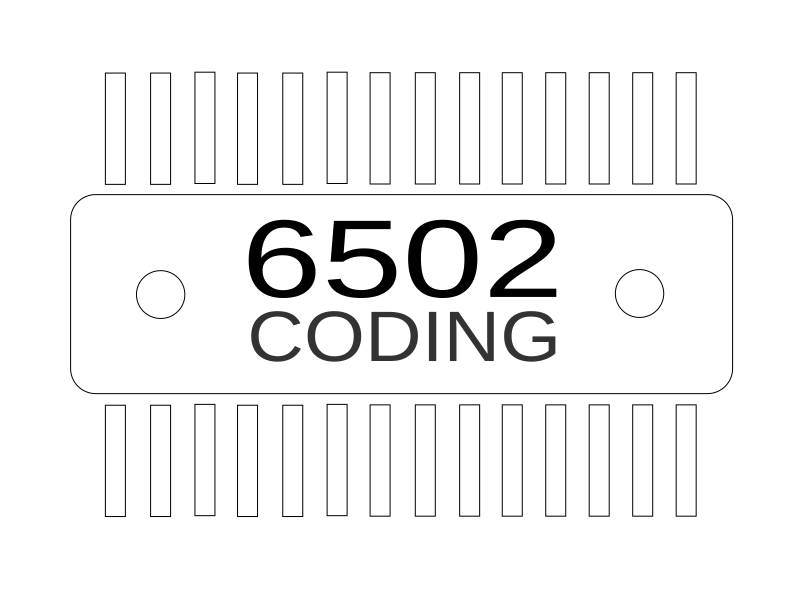
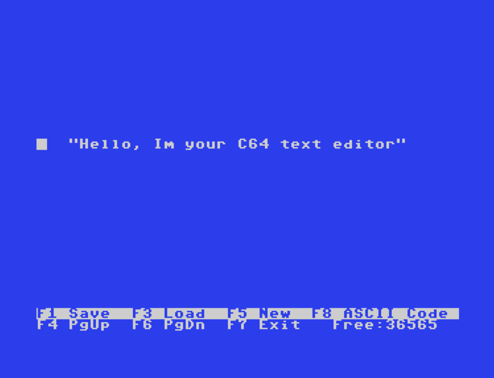
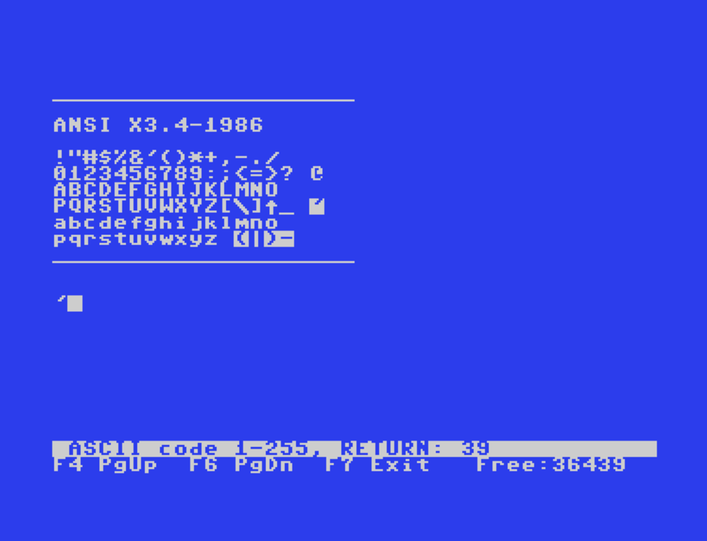

# C64 ASCII Text Editor 
A text editor capable of loading, editing, and saving ASCII text.  
  
<p>

  
</p>  

You can open and edit text files that you’ve transferred to the C64 from Windows or Linux. After editing them on the C64, you can process the text file on your PC again—it remains compatible.  
The editor supports the 7-bit ASCII character set (ANSI X3.4-1986), with the exception of the NUL and CR characters, which are deliberately ignored when loading a file.  
Special characters are converted to suitable C64 screen codes for display.  
  
### Features
  
- Files are saved as C64 SEQ files containing plain ASCII text.  
  (On Windows, the file extension must be changed to `.txt`.)
- Optional line endings: LF or CRLF.
- Text buffer at `$4000–$CEFF` (approximately 36 KB); BASIC ROM is switched off.
- RAM consumption approx. 5 kB.
- The uppercase/lowercase character set is copied to RAM at `$3000`.
- All keyboard input is converted to ASCII.  
- Characters that cannot be entered directly via the keyboard can be entered manually using F8.  
- German UTF-8 umlauts are displayed as inverted characters, no conversion in the text.  
   
### ANSI X3.4-1986 characters  
```
!"#$%&'()*+,-./ 
0123456789:;<=>? @  
ABCDEFGHIJKLMNO  
PQRSTUVWXYZ[\]^_ `  
abcdefghijklmno   
pqrstuvwxyz {|}~   
```  
  
### Keyboard controls:  
    F1 = Save   F3 = Load   F5 = New   F7 = Quit  
      
    Cursor keys  =  Move cursor       HOME    =   Start of line  
    DEL          =  Backspace         CLR     =   Start of text  
    SHIFT+DEL    =  Delete (INST)     F2      =   End of text  
    RETURN       =  New line          F4 / F6 =  Page up / down  
    CTRL+I       =  Tabulator
  
    Direct character input on the C64 keyboard:  
        Pound key                    = Backslash \  
        SHIFT+-                      = Underscope _ 
        Left-arrow key               = Underscore _  
        | (key before RESTORE)       = ASCII character pipe (|)         
        SHIFT+| (key before RESTORE) = ^  
        SHIFT+: = [          SHIFT+; = ]  
    F8 = Allows any ASCII code to be inserted (decimal values)  
         33 – 126 = ASCII text characters    
         0 – 32 = control characters, 127 = DEL  
         (Inputs of 0 and 13 are ignored)  
  
         Examples of decimal values:  
         126 = ~  125 = }  123 = {  96 = `  9 = Tab   
  
         Umlauts as Unicode input:  
         228 = ä  246 = ö  252 = ü  
         196 = Ä  214 = Ü  220 = Ü  223 = ß  
  
    Alternative character representation:  
        { } = displayed as inverted parentheses ()  
         ~  = displayed as an inverted minus sign -  
         german UTF-8 umlauts = displayed as inverted ASCII character  
  
Start the program from floppy disk using `LOAD"TEXTEDITOR",8,1` and `RUN`.
  
     
### $\color{#8B0000}{\textbf{AI alert:}}$  
- The code was created with the assistance of Claude.  
   
### Useful Information
PETSCII-Codes
```  
https://www.c64-wiki.de/wiki/PETSCII  
```  
ANSI X3.4
```  
https://en.wikipedia.org/wiki/ASCII  
```  
  
   
